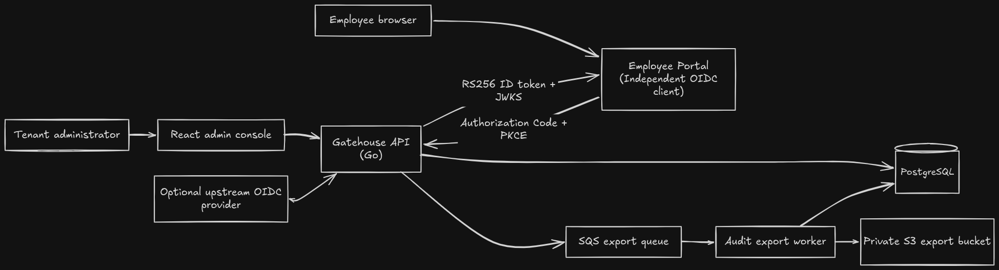
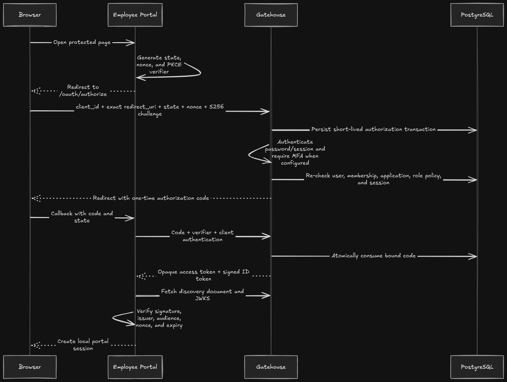

# Gatehouse

Gatehouse is a multi-tenant identity provider and access-control platform. Organizations register applications, manage members, roles, and MFA, and delegate application login through an OpenID Connect Authorization Code + PKCE flow. Gatehouse evaluates access, issues a signed identity token, and records an audit trail of the decision.

## Jump to

- [Why Gatehouse exists](#why-gatehouse-exists)
- [Architecture](#architecture)
- [What is implemented](#what-is-implemented)
- [Security invariants](#security-invariants)
- [Run the browser demo](#run-the-browser-demo)
- [Local development](#local-development)
- [Verification commands](#verification-commands)
- [Technologies used](#technologies-used)

## Why Gatehouse exists

Most internal applications need the same basic identity features: login, MFA, roles, access rules, and a way to remove users safely. Rebuilding those features in every application is repetitive and makes them harder to manage consistently. Gatehouse brings them together in one service:

- Administrators can manage members, roles, applications, and access policies in one place.
- Users sign in once through Gatehouse and complete TOTP when it is required.
- Applications integrate through OIDC, so they never need to handle a user's Gatehouse password.
- Important identity and access changes are recorded in a central audit trail.

To demonstrate the flow end to end, the repository includes a separate Go Employee Portal. It redirects users to Gatehouse, exchanges the one-time authorization code, validates the signed ID token through discovery and JWKS, and creates its own application session.

## Architecture



Tenant context never comes from browser input or queue messages alone. PostgreSQL remains the source of truth for tenants, memberships, sessions, authorization transactions, application policies, audit events, and export jobs.

### OIDC login path



## What is implemented

### Identity and tenant administration

- Tenant registration with a transactional owner membership and built-in roles.
- Password authentication, email verification, opaque server-side sessions, and session rotation.
- TOTP enrollment and challenge, encrypted TOTP seeds, replay protection, and one-time recovery codes.
- Membership invitations, role/status changes, offboarding, and final-owner protection.
- Fixed permission catalog, built-in roles, and tenant-scoped custom roles.
- React administration UI for members, roles, applications, access policies, and audit events.

### OIDC provider

- Discovery and JWKS endpoints with an environment-injected RSA signing key and `kid`.
- Public and confidential clients with exact redirect URI matching.
- Confidential client secrets are displayed once and stored only as hashes.
- Authorization Code flow with `state`, `nonce`, and mandatory S256 PKCE.
- Server-side authorization transactions that survive login and MFA redirects.
- Application policy for all active members or selected tenant roles.
- Atomic, single-use authorization code redemption bound to client, redirect URI, and PKCE verifier.
- RS256 ID tokens and opaque short-lived access tokens.
- Optional tenant-level upstream OIDC federation with discovery, PKCE, state/nonce validation, SSRF restrictions, and explicit identity mapping.

### Audit and operations

- Structured audit events with allowlisted metadata for authentication, MFA, membership, RBAC, applications, authorization, token exchange, sessions, and federation.
- Transactional audit writes for security mutations.
- Filterable audit UI by actor, application, event, outcome, and time.
- Asynchronous audit exports through SQS and a standalone, lease-fenced worker, with CSV/JSON output in S3, bounded retries, idempotency, and a DLQ.
- Structured request logs with request, tenant, user, and application identifiers where safe.
- Terraform modules for VPC networking, private RDS, ECS/Fargate, ALB, ECR, SQS/DLQ, S3, Secrets Manager references, log groups, and CloudWatch alarms.
- GitHub Actions workflows for pull-request checks and a protected AWS deployment path with immutable image tags and ECS rollback.

## Security invariants

The design is built around a small set of properties that are enforced in services, SQL, constraints, and adversarial tests:

1. A tenant-scoped identifier cannot switch a request to another tenant.
2. Gatehouse never redirects an OAuth response before validating the client and exact callback URI.
3. Required MFA must be completed before an authorization grant is issued.
4. Authorization codes are high-entropy, stored as hashes, client/redirect/PKCE-bound, and consumed once atomically.
5. Disabled users, memberships, applications, and revoked sessions cannot create new grants or redeem issued codes.
6. Browser role, permission, tenant, and application claims are never treated as authority.
7. SQS messages contain only a job ID. The worker reloads tenant and export scope from PostgreSQL.
8. Secrets, tokens, request bodies, and OAuth query values are excluded from structured request and audit metadata.

## Run the browser demo

### Prerequisites

- Go 1.26.4 or the version declared in `backend/go.mod`.
- Node.js 24 and Corepack/pnpm.
- Docker with the Compose plugin.
- OpenSSL and `curl`.

Install the frontend dependencies and Chromium once:

```bash
corepack enable
cd web
pnpm install --frozen-lockfile
pnpm exec playwright install chromium
cd ..
```

Run the browser suite:

```bash
make test-e2e
```

The main browser test covers Alice signing in to the Employee Portal, Bob being denied by the application’s role policy, Alice changing Bob’s role, and Bob gaining access afterward.

Before the browser suite runs, the E2E setup resets the disposable `gatehouse_test` database on port `5433` and seeds it with fixed test identities and credentials.

## Local development

### 1. Install dependencies

```bash
corepack enable
cd web
pnpm install --frozen-lockfile
cd ..
```

Go downloads the backend and Employee Portal dependencies automatically when their commands first run.

### 2. Create local configuration

```bash
cp .env.example .env
mkdir -p backend/.local
openssl genpkey -algorithm RSA -pkeyopt rsa_keygen_bits:2048 \
  -out backend/.local/oidc-signing-key.pem
```

Generate two independent 32-byte keys:

```bash
openssl rand -base64 32
openssl rand -base64 32
```

Paste the first value into `MFA_ENCRYPTION_KEY_BASE64` and the second into `CSRF_HMAC_KEY_BASE64` in `.env`. The remaining defaults are suitable only for direct local HTTP development.

### 3. Start Gatehouse

```bash
make dev
```

This starts PostgreSQL, applies migrations, and runs:

| Service                                 | Local URL                                                |
| --------------------------------------- | -------------------------------------------------------- |
| Admin console                           | `http://localhost:5173`                                  |
| Gatehouse API                           | `http://localhost:8080`                                  |
| OIDC discovery through the local issuer | `http://localhost:5173/.well-known/openid-configuration` |

In local development, Gatehouse writes verification and invitation links to the API log for convenience. This behavior requires `ALLOW_INSECURE_EMAIL_LOGGING=true`. ECS disables it, so the API fails to start until a production email provider is configured.

### 4. Connect the Employee Portal manually

1. Register a tenant, open the verification link from the API log, and sign in.
2. Create a **confidential** application named Employee Portal.
3. Add the exact callback URI `http://localhost:8090/oauth/callback`.
4. Choose either all active members or an allowed-role policy.
5. Copy the client ID and the one-time client secret.
6. Put them in `.env` as `EMPLOYEE_PORTAL_OIDC_CLIENT_ID` and `EMPLOYEE_PORTAL_OIDC_CLIENT_SECRET`.
7. Restart `make dev` and open `http://localhost:8090`.

The client secret cannot be recovered from a later application read.

Press `Ctrl+C` to stop the application processes. Stop the reusable development and test database containers with:

```bash
make stop
```

## Verification commands

```bash
# Backend, frontend, and Employee Portal tests plus lint/typecheck/build/vet
make check

# Real browser flows across Employee Portal -> Gatehouse -> callback
make test-e2e

# Terraform formatting, validation, and mock-provider security contracts
make terraform-check

# Regenerate sqlc code after changing SQL queries
make generate
```

`make check` starts the disposable PostgreSQL test service. The integration suite runs real migrations and real PostgreSQL transactions.

The pull-request workflow separates application checks, Playwright, Terraform contracts, and hardened container builds. Action versions are pinned by commit SHA. See [`.github/workflows/pr.yml`](.github/workflows/pr.yml).

## Technologies used

| Area                      | Technologies                                                                |
| ------------------------- | --------------------------------------------------------------------- |
| API and workers           | Go, chi, pgx, sqlc                                                    |
| Persistence               | PostgreSQL 17, Goose migrations                                       |
| Admin console             | React, TypeScript, Vite, TanStack Query, Tailwind CSS                 |
| Browser testing           | Vitest, Testing Library, Playwright                                   |
| Protocol and cryptography | Narrow OIDC Code flow, PKCE S256, RS256, opaque sessions/tokens, TOTP |
| Async exports             | Amazon SQS, S3, DLQ, lease-fenced worker                              |
| Infrastructure            | Terraform, ECS/Fargate, ALB, RDS, ECR, Secrets Manager, CloudWatch    |
| Delivery                  | GitHub Actions with GitHub OIDC to AWS                                |
